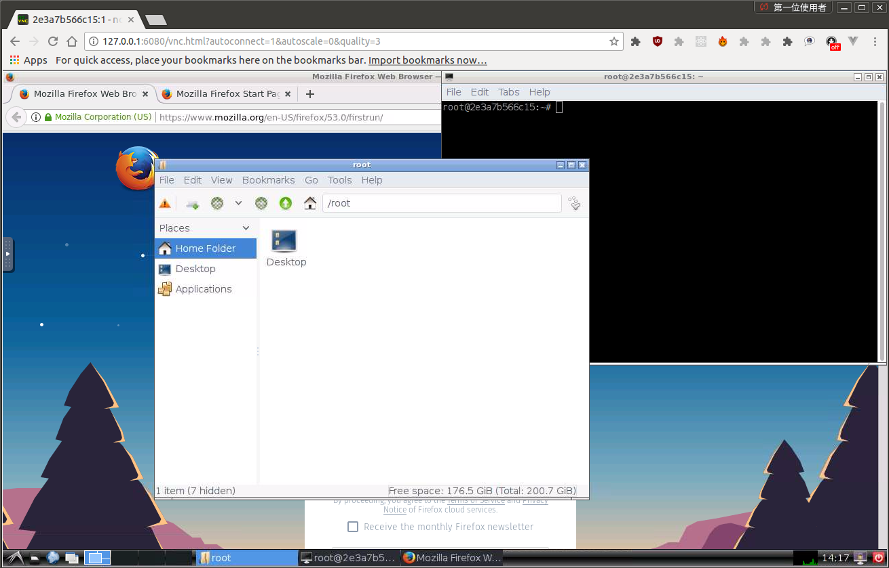

# ubuntu_vnc_lxde_yocto

A full Ubuntu 18.04 LXDE desktop in a container, reachable from a browser or a
VNC viewer, preloaded with the host packages needed to build Yocto and NXP i.MX
BSPs — plus an interactive menu for fetching Poky, `repo`, and an i.MX BSP.

> **Status: unmaintained hobby project.** It is kept building and honest, not
> current. The base image is deliberately Ubuntu 18.04, which is past standard
> support. **Read [SECURITY.md](SECURITY.md) before exposing any port**, because
> there is no authentication unless you ask for it.

## Overview

The container serves two purposes:

1. A full Ubuntu 18.04 install with an LXDE GUI (and optional sound), so you can
   do anything in it you would normally do in Ubuntu.
2. An interactive terminal menu that installs Yocto Poky, Google's `repo` tool,
   and an NXP i.MX BSP into the container.

The original intent was to also run this natively on an i.MX 8 (or any i.MX part
that can run a Docker engine) so the SoC drives a local screen — pull and run,
instead of a full native install. See `Dockerfile.armhf`, which is **untested**.

Tested by the author on an Acer Aspire E 17 running Ubuntu 18, and on the same
laptop running Windows 10 + VirtualBox with an Ubuntu VM hosting Docker.

## Quick start

```bash
make build
make run
```

Then browse to **http://127.0.0.1:6080/**

`make run` publishes only to `127.0.0.1` on purpose — see [SECURITY.md](SECURITY.md).



### Make targets

| Target | What it does |
|---|---|
| `make build` | Build `kylefoxaustin/ubuntu_vnc_lxde_yocto:latest` |
| `make run` | Run it; browser client on `http://127.0.0.1:6080/` |
| `make run-vnc VNC_PASSWORD=…` | As above plus VNC on `127.0.0.1:5900`; **refuses to run without a password** |
| `make shell` | `bash` inside the running container |
| `make stop` | Stop and remove *this project's* container only |
| `make clean` | `stop`, then remove the built image |
| `make gen-ssl` | Generate a self-signed cert into `./ssl` |

Add `LOCALBUILD=1` to `make build` to fetch packages from a Taiwan mirror.

## Configuration

All of these are `docker run -e NAME=value`:

| Variable | Effect |
|---|---|
| `HTTP_PASSWORD` | Enable HTTP basic auth on the web client. **Set this.** |
| `VNC_PASSWORD` | Require a password for port 5900. **Set this if you publish it.** |
| `USER`, `PASSWORD` | Create and use a non-root desktop user (default: `root`) |
| `RESOLUTION` | Fixed screen size, e.g. `1920x1080` (default `1024x768`) |
| `SSL_PORT` | Serve HTTPS on this port; mount certs at `/etc/nginx/ssl` |
| `ALSADEV` | ALSA device for sound, e.g. `hw:2,0` |

### VNC viewer

```bash
make run-vnc VNC_PASSWORD=mypassword
# then point your viewer at 127.0.0.1:5900
```

### SSL

```bash
make gen-ssl
docker run --rm -p 127.0.0.1:6081:443 \
  -e SSL_PORT=443 -e HTTP_PASSWORD=mypassword \
  -v ${PWD}/ssl:/etc/nginx/ssl \
  kylefoxaustin/ubuntu_vnc_lxde_yocto
```

### Sound (Linux hosts only)

Insert the loopback module, then grant the device to the container:

```bash
sudo modprobe snd-aloop index=2
docker run --rm -it -p 127.0.0.1:6080:80 \
  --device /dev/snd -e ALSADEV=hw:2,0 \
  kylefoxaustin/ubuntu_vnc_lxde_yocto
```

Then launch Chromium from the start menu under *Internet → Chromium Web Browser
Sound*. Note that wrapper passes `--no-sandbox`; see [SECURITY.md](SECURITY.md).

## The Yocto menu

On first start, `startup.sh` presents a menu that can:

1. **Install Poky** — clones `https://git.yoctoproject.org/poky` into `$HOME/poky`
   and checks out `yocto-2.5`, then optionally sources `oe-init-build-env`.
2. **Install `repo`** — fetches Google's `repo` tool into `/usr/local/bin`.
3. **Install an i.MX BSP** — uses `repo` to fetch an NXP i.MX BSP manifest.
4. **Advanced** — run an arbitrary command.

The Yocto and NXP i.MX host-package sets are baked into the image, so a build
host is ready without further `apt-get`.

## What changed in the 2026 cleanup

The repo had **287 open Dependabot alerts** and a build that failed on a dead
download URL. Both are resolved. In short:

- **287 → 0 dependency alerts**, by deleting dead code rather than pinning it.
  243 came from a Node 8 + Vue 2 frontend toolchain whose output never shipped in
  the image; 40 came from a Python 2 Flask backend that could not be upgraded on
  this base (Ubuntu 18.04 ships Python 3.6; modern Flask needs ≥ 3.8). The
  browser client is now noVNC served as static files — no build step at all.
- **Supply-chain fixes**: package signature verification re-enabled
  (`--allow-unauthenticated` removed), `tini` pinned and SHA256-verified instead
  of an unchecked `ADD` from a URL, and `curl | bash` of the EOL Node 8 installer
  removed along with the builder stage.
- **A dead build step removed**: the ffmpeg tarball URL returns **404**, so the
  build could not complete. It was only needed by the removed video feature.
- **Real bugs fixed**, including a `HEALTHCHECK` whose URL was
  `http://127.0.0.1:/6079/api/health` — a misplaced colon meant the port was
  empty and the check could never pass; and a `cleanrun` script that ran
  `docker rm $(docker ps -aq)`, deleting **every container on the host**.
- **Safer defaults**: ports bind to `127.0.0.1`, `make run-vnc` refuses to
  publish VNC without a password, and startup warns when either entry point is
  unauthenticated.
- Docs now describe *this* image. The previous README was largely upstream's,
  so every example told you to run `dorowu/ubuntu-desktop-lxde-vnc` instead.

Removed with the Python backend: `/api/state`, `/api/reset` (resolution changes
over HTTP) and `/api/live.flv` (the FLV video/audio stream). Plain VNC is
unaffected. Full reasoning in [SECURITY.md](SECURITY.md).

## Credits

Built on [fcwu/docker-ubuntu-vnc-desktop](https://github.com/fcwu/docker-ubuntu-vnc-desktop)
by **Doro Wu** (fcwu.tw@gmail.com) — many thanks for the original LXDE/VNC image.
The browser client is [noVNC](https://github.com/novnc/noVNC) (vendored, 1.0.0-testing.2).

## Maintainer

**Kyle Fox** — [github.com/kylefoxaustin](https://github.com/kylefoxaustin)

Happy coding.

## License

See [LICENSE](LICENSE).
